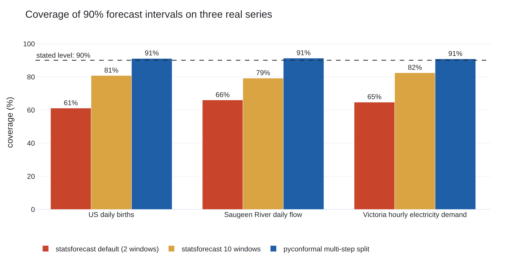
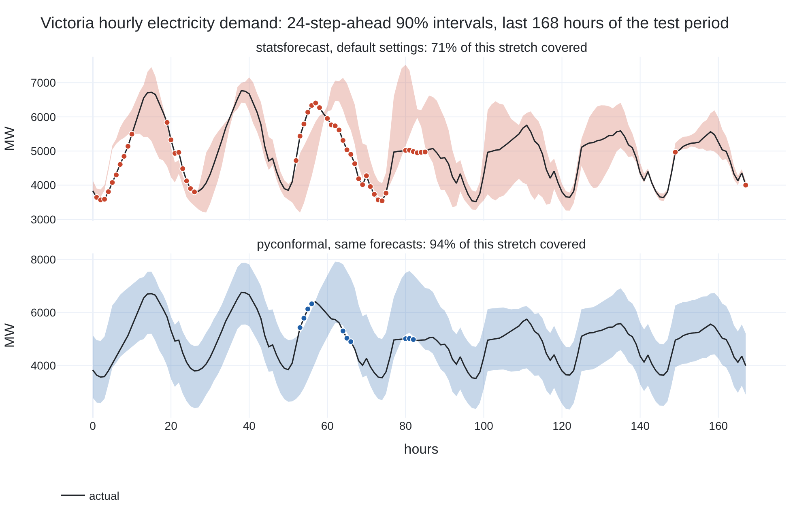

# pyconformal

**Conformal prediction that is exact, fast, and covers both tabular data and time series.**

**Documentation: https://valeman.github.io/pyconformal/** (every method with a minimal example you can run)

[](https://valeman.github.io/pyconformal/)
[](https://github.com/valeman/pyconformal/actions/workflows/tests.yml)
[](https://github.com/valeman/pyconformal/blob/main/project/CHANGELOG.md)
[](pyproject.toml)
[](LICENSE)
[](pyproject.toml)
[](https://github.com/valeman/pyconformal/stargazers)

<p>
  <a href="https://buymeacoffee.com/valeman"></a>
  &nbsp;&nbsp;
  <a href="https://buymeacoffee.com/valeman"></a>
</p>

Prediction intervals, prediction sets, predictive distributions and calibrated
probabilities for any model, with finite-sample guarantees wherever the method
has one ([which do](#the-guarantee-and-its-limits)). About thirty methods
behind one interface. NumPy is the only requirement. MIT licence.

```python
from catboost import CatBoostRegressor
from sklearn.datasets import make_regression
from pyconformal import SplitConformalRegressor

X, y = make_regression(n_samples=3000, n_features=5, noise=10, random_state=0)
X_train, X_cal, X_test = X[:1000], X[1000:2000], X[2000:]
y_train, y_cal, y_test = y[:1000], y[1000:2000], y[2000:]

model = CatBoostRegressor(verbose=0, random_seed=0)   # or XGBoost, LightGBM, any scikit-learn-style model
cp = SplitConformalRegressor(model, alpha=0.1)
cp.fit(X_train, y_train)
cp.calibrate(X_cal, y_cal)
intervals = cp.predict_interval(X_test)                       # covers at least 90% on average
print(((intervals[:, 0] <= y_test) & (y_test <= intervals[:, 1])).mean())   # 0.892
```

No model object? Pass its outputs: `cp.calibrate(y_pred=pred_cal, y=y_cal)`.

**[Install](#install) · [What you get](#what-you-get) · [Quick tour](#one-interface) · [Why it exists](#why-it-exists) · [On real data](#on-real-data) · [Speed](#speed-method-by-method) · [User guide](https://github.com/valeman/pyconformal/blob/main/project/docs/guide.md)**

**Documentation: [every method with a minimal example](https://valeman.github.io/pyconformal/whats-inside/) · [FAQ](https://valeman.github.io/pyconformal/faq/)**

## Install

```bash
pip install "pyconformal[fast]"
```

With conda, install into an environment of its own:

```bash
conda create -n pyconformal -c conda-forge python=3.12 pip
conda activate pyconformal
pip install "pyconformal[fast]"
```

Python 3.10 or later. `[fast]` adds numba. Without it everything runs on NumPy
alone, more slowly, except `QuantileForest` and `SPCI` (which uses it): those
two need numba. The example above also needs `catboost` for the model and scikit-learn for the data.

The development version, ahead of the latest release:

```bash
pip install "pyconformal[fast] @ git+https://github.com/valeman/pyconformal"
```

## What you get

| | Methods |
|---|---|
| **Regression** | Split conformal (normalized, Mondrian, weighted) · jackknife+ and CV+ · CQR · CTI · CIR and CIR+ · a parallel quantile forest with out-of-bag calibration |
| **Classification** | LAC · APS · RAPS · SAPS, randomised or not, marginal, per class or per category (Mondrian) |
| **Probability calibration** | Venn-Abers and cross Venn-Abers, binary and multiclass |
| **Distribution-valued outcomes** | Conformal sets for distribution-to-distribution regression, with a band for the distribution function |
| **Panel data** | W-TQA and TQA: sets for one unit calibrated on its peers in the same round, with late or missing feedback · predictive quantiles on a grid of levels for each unit (`PanelPredictiveSystem`, from version 0.1.5) |
| **Quantile forecasts under drift** | MultiQT: many levels kept calibrated online, never crossing |
| **Predictive distributions** | Conformal predictive systems: quantiles, distribution function, intervals, exact CRPS |
| **Time series, online** | ACI · DtACI · AgACI · NexCP · conformal PID |
| **Time series, ensembles** | EnbPI · SPCI |
| **Time series, several steps ahead** | Multi-step split conformal · AcMCP · conformal seasonal pools |
| **Decomposition** | STL and MSTL, matching R to 14 decimal places |

## Works with CatBoost, XGBoost and LightGBM

Pass the model straight in; no wrapper is needed. Tested with CatBoost 1.2,
XGBoost 3.4 and LightGBM 4.7, regressors and classifiers:

| Method | How to use it |
|---|---|
| Split conformal, jackknife+ and CV+, predictive systems, EnbPI | `SplitConformalRegressor(CatBoostRegressor())` |
| CQR | two quantile models: `ConformalizedQuantileRegressor((low_model, high_model))` |
| Prediction sets, Venn-Abers | `SplitConformalClassifier(CatBoostClassifier())`, `VennAbers(CatBoostClassifier())` |
| CTI and CIR | need many quantile levels from one model: `ConformalInterquantileRegressor(QuantileBooster("catboost"))` |

`QuantileBooster` trains the quantile levels with whichever library you name
and hands them to CQR, CTI and CIR. Against Zillow's quantile-forest on
California housing (5 splits, 90% target, same rows for every model):

| Quantile model | Pinball loss | CQR width | CIR+ width | Fit | Predict 101 levels |
|---|---|---|---|---|---|
| quantile-forest (Zillow) | 0.129 | 1.87 | 1.43 | 1.5 s | 0.14 s |
| pyconformal `QuantileForest` | 0.124 | 1.70 | 1.41 | 0.23 s | 0.08 s |
| `QuantileBooster("catboost")` | 0.119 | 1.36 | 1.38 | 6.4 s | 0.02 s |
| `QuantileBooster("xgboost")` | 0.123 | 1.49 | 1.40 | 9.2 s | 0.28 s |
| `QuantileBooster("lightgbm")` | 0.116 | 1.36 | 1.34 | 7.1 s | 0.98 s |

Coverage was 90% for every row. Boosters gave shorter intervals here and take
longer to train; on a few hundred rows they overfit and the forest is the
better choice. Five datasets and the details: [user guide](https://github.com/valeman/pyconformal/blob/main/project/docs/guide.md#quantile-models-from-catboost-xgboost-and-lightgbm).

## One interface

The same four verbs for every method: `fit` trains the model, `calibrate`
uses held-out data, `predict_*` gives the output, and `update` (or `run`, for
a whole history) serves online methods. `alpha` is the miscoverage level:
0.1 means 90%.

```python
from pyconformal import (SplitConformalClassifier, VennAbers,
                         ConformalPredictiveSystem, AdaptiveConformalInference)

# Prediction sets
cp = SplitConformalClassifier(clf, alpha=0.1, score="aps").calibrate(X_cal, y_cal)
sets = cp.predict_set(X_test)

# Calibrated probabilities with a validity guarantee
proba = VennAbers(clf).calibrate(X_cal, y_cal).predict_proba(X_test)

# A full predictive distribution per sample
cps = ConformalPredictiveSystem(model).calibrate(X_cal, y_cal)
cps.predict_quantile(X_test, [0.05, 0.5, 0.95]); cps.predict_cdf(X_test, 100.0)

# Time series: replay a history, then go live
aci = AdaptiveConformalInference(alpha=0.1)
aci.run(y_pred=forecasts, y=actuals).coverage
aci.predict_interval(y_pred=next_forecast)
aci.update(y_pred=next_forecast, y=next_actual)
```

Results are plain NumPy arrays. The **[user guide](https://github.com/valeman/pyconformal/blob/main/project/docs/guide.md)** has a
section and an example for every method.

## Why it exists

Split conformal prediction makes one promise. If the calibration scores and
the next score are exchangeable and computed by the same rule, a 90% interval
covers the next outcome with probability at least 90%, on average over
calibration sets and new examples, for any model and any calibration size.
Other conformal methods promise other things (ACI a long-run miss rate, risk
control a bound that fails rarely). We tested the current releases of
fourteen packages on data where each promise must hold, and then
went through five conformal libraries module by module: MAPIE, crepes, PUNCC,
TorchCP and conformal-tights (20 to 25 November 2026). The reports and scripts
are in this repository.

**Coverage or risk control below the target.** The rows measure different
things, named in the Target column: coverage of a set or interval, the
long-run miss rate of an online method, a whole box inside another, or how
often a risk bound fails. Most of these happen with no error and no warning.

| Package | Setting | Target | Measured |
|---|---|---|---|
| TorchCP 1.2.1 | `SAPS(randomized=False)`, an accurate classifier | 90% coverage | **0% to 36%** |
| PUNCC 0.9.3 | box-wise object detection, detector's boxes too small | 90% of true boxes inside | **0%** |
| TorchCP 1.2.1 | AgACI on drifting series | 10% misses | **27% to 45% misses** |
| PUNCC 0.9.3 | APS and RAPS, one row per `predict` call | 90% coverage | **45%** (68% with two rows, 89% with five) |
| TorchCP 1.2.1 | CQR-R | 90% coverage | **57.6%**, the same as the raw quantile band; ordinary CQR on the same data covers 90.2% |
| statsforecast 2.1.1, mlforecast 1.1.0 | conformal intervals with the default of 2 calibration windows | 90% coverage | **63% to 65%** |
| MAPIE 1.6.0 | ACI on drifting series | 10% misses | **14% to 33% misses** |
| TorchCP 1.2.1 | ACI with random-walk errors | 10% misses | **14.0% misses** |
| Darts 0.48.1, conformalpy 1.0.0 | 3 calibration points | 90% coverage | **75%** (conformalpy warns that the calibration set is small) |
| conformal-tights 0.5.0 | defaults, 300 rows, eight public datasets | 90% coverage | **80.6%** (84.2% with 1,000 rows, 87.2% with 5,000) |
| MAPIE 1.6.0 | APS and RAPS with `include_last_label=False` | 90% coverage | **81.5% and 83.6%** |
| crepes 0.9.1 | out-of-bag calibration with k-nearest-neighbour difficulty, as in its notebook | 90% coverage | **83.6%** with k = 5, 88.1% with the default k = 25 |
| TorchCP 1.2.1 | NorABS used as its docstring says (computed from its scores, because its interval call fails on batches) | 90% coverage | **83.6%** |
| MAPIE 1.6.0 | default RCPS confidence bound | bound below the true risk in at most 10% of runs | **up to 19.7%** (12.3% through the public class) |
| TorchCP 1.2.1 | `ConformalLM` with a scaler | risk above its limit in at most 5% of draws | **25.5%** |

On the same tests pyconformal behaved as the theory says: its ACI missed 10.1%
on the drifting series, split conformal covered 90.0% on the eight datasets
with 300 rows, and its APS, RAPS and SAPS sets were identical whether rows were predicted
together or one at a time (0 of 3,000,000 decisions differed) and covered
90.0% over 300 splits.

**Wrong or unusable results.**

| Package | What happens |
|---|---|
| crepes 0.9.1 | A test object in a Mondrian category that was not in calibration gets the interval [0, 0], with no warning |
| crepes 0.9.1 | CRPS with difficulty estimates: 7.19 reported where 2.19 is correct |
| crepes 0.9.1 | `MondrianCategorizer` fitted with `learner=` raises `NameError`; `predict(seed=)` leaves NumPy's global random state reset |
| TorchCP 1.2.1 | NorABS raises an error on any batch of more than one row |
| TorchCP 1.2.1 | `ClusteredPredictor` returns every label for classes without a cluster; `WeightedPredictor` sorts weights separately from scores and returns sets 41% to 62% larger than correct weighting |
| MAPIE 1.6.0 | The default Holm procedure in learn-then-test returns no threshold in 161 of 300 runs where Bonferroni returns one in all 300 |
| PUNCC 0.9.3 | EnbPI crashes when residuals are updated after every observation |
| conformal-tights 0.5.0 | Sample weights are ignored in its calibration step: with corrupted rows given weight zero the interval is three times wider than a fit on the clean rows alone |

**Two patterns are worth knowing.** MAPIE and TorchCP both clip the working
level of ACI. Adaptive conformal inference is defined without a clip, and its
guarantee, validity under any drift, needs the level to be free to leave
[0, 1]. On stationary data the clip rarely binds, so ordinary tests pass; on
drifting data the guarantee is gone. And crepes and TorchCP both let a
calibration object be its own nearest neighbour when estimating difficulty,
which gives the same 83.6% in both.

**What was correct.** The basic split-conformal regression and classification
routines of MAPIE, crepes, PUNCC and TorchCP met their level in every coverage
test, and where a finite interval is valid their thresholds were the exact rank
(crepes one rank too high in 40 of 1,240 cases, which is safe). The faults sit in
options, newer modules and time-series methods. With two calibration errors no
finite 90% interval is valid for an unbounded outcome; at least nine are needed,
and below that the valid answers are an infinite interval or a refusal. The statsforecast behaviour is
[issue #1349](https://github.com/Nixtla/statsforecast/issues/1349). Some items
were already on the projects' trackers (MAPIE issue #1021 and pull request #998, crepes #40 and
#54, TorchCP #126); the reports say which.

Full reports, with scripts and raw output:
[MAPIE](project/benchmarks/mapie_audit/README.md) ·
[crepes](project/benchmarks/crepes_audit/README.md) ·
[PUNCC](project/benchmarks/puncc_audit/README.md) ·
[TorchCP](project/benchmarks/torchcp_audit/README.md) ·
[conformal-tights](project/benchmarks/conformal_tights_audit/README.md)

**MAPIE is correct in almost everything we tested. Its costs are elsewhere.** Of the
84 coverage configurations we ran, 78 met their target (for jackknife+ and
CV+ the target is their proven bound of 80% at a 90% setting) and 6 refused
to run because the calibration set was too small, which is safe behaviour.
Four faults lie outside those 84, all reproduced on MAPIE 1.6.0 ([full audit](project/benchmarks/mapie_audit/README.md)). ACI clips its working level to [0, 1], so it is not the algorithm of Gibbs and Candès and loses their guarantee on drifting data (miss rates of 14% to 33% at a 10% target, where an unclipped ACI gives 10.1%). APS sets with `include_last_label=False` cover 81% at a 90% target (their issue #1021; the default covers 95%). The default RCPS confidence bound is computed on two halves of the data and falls below the true risk in up to 20% of runs where 10% is allowed (their pull request #998, closed unmerged). The default Holm procedure in learn-then-test returns no threshold when one p-value is undefined. Its other problems are speed,
memory, and sets that are larger than they need to be:

| | MAPIE 1.6.0 | pyconformal | Times faster | Output |
|---|---|---|---|---|
| Venn-Abers, 1,000,000 points | 61.9 s, 244 to 360 numerical warnings per fit | 0.33 s, none | **188x** | identical |
| ACI, backtest of 20,000 steps | 8.1 s | 0.003 s | **about 2,000x** | same coverage |
| ACI, one row at a time | 0.57 ms per step | 0.09 ms | **6x to 8x** | same coverage |
| EnbPI, backtest | 5.5 ms per step | 0.012 ms | **400x to 470x** | same coverage |
| EnbPI, one row at a time | 5.8 ms per step | 2.2 ms | **2.5x** | same coverage |
| CV+ prediction, 2,000 to 5,000 training rows | 2 to 5 s | 0.12 to 0.18 s | **17x to 27x** | same coverage |
| CV+, 20,000 training by 20,000 test rows | out of memory on a 7 GB machine | runs; also at 100,000 rows | | |
| CQR, 1,000,000 test points | 19.7 ms | 3.2 ms | **6x** | identical |
| Prediction sets (LAC, APS, RAPS), 10 to 1,000 classes | 0.010 to 1.8 s | 0.001 to 0.36 s | **5x to 10x** | |
| Split regression, 1,000,000 test points | 8.9 ms | 1.9 ms | **4.7x** | identical |

Sets and scope:

| | MAPIE 1.6.0 | pyconformal |
|---|---|---|
| APS at a 90% target, default settings | covers 97.5%, mean set 2.05 classes (18% larger than needed) | covers 89.9%, mean set 1.73 |
| RAPS at a 90% target, default settings | covers 96.9%, mean set 2.11 classes (22% larger than needed) | covers 89.9%, mean set 1.73 |
| RAPS with 1,000 classes and 5,000 calibration points | error: needs two calibration points in every class | runs |
| Time-series methods | 2 (ACI, EnbPI) | 10 |
| Predictive distributions, CTI, CIR | not available | available |

The backtest rows and the one-row-at-a-time rows measure different things: in
a backtest pyconformal calls the model once for the whole history, where
MAPIE's interface calls it at every step.

**Other correct packages are slow in the same way.**

| Task | Other package | pyconformal | Times faster | Output |
|---|---|---|---|---|
| Venn-Abers calibration, 1,000,000 points | 61.5 s (venn-abers) | 0.33 s | **188x** | identical |
| Predictive intervals, 1,000,000 test points | 79 s (crepes) | 0.01 s | **8,100x** | identical |
| Predictive distribution function, 1,000,000 test points | 145 s (crepes) | 0.26 s | **556x** | identical |
| CRPS, 5,000 test points | 0.31 s (crepes) | 0.0005 s | **656x** | identical without difficulty estimates |
| Multi-step forecast intervals, 3,000 steps × 12 horizons | 42 s (R conformalForecast) | 0.01 s | **over 4,000x** | identical |
| AcMCP, 1,000 steps × 6 horizons | 107 s (R conformalForecast) | 2.5 s | **43x** | median difference 0.00001 |
| Conformal PID, per step | 10 to 14 µs (authors' code) | 0.09 to 0.13 µs | **106x to 112x** | identical |
| CTI, 200,000 test points | 0.43 s (authors' code) | 0.023 s | **19x** | identical |
| CIR, 200,000 test points | 1.85 s (authors' code) | 0.12 s | **16x** | identical in the authors' mode, which has no coverage guarantee (see below) |
| MSTL decomposition, 100,000 points | 19.3 s (statsforecast, its defaults) | 0.098 s | **about 200x** (6x to 7x at equal settings) | identical at equal settings |
| Quantile forest, fit on 1,000,000 rows (16 cores) | 215 s (quantile-forest) | 27 s | **8x** | same accuracy |

**No package covers both worlds.** Tabular libraries carry a couple of
time-series methods; forecasting libraries carry a couple of conformal ones.

## On real data

We tested pyconformal against Nixtla's statsforecast 2.1.1 on three public series. statsforecast makes every point forecast; both libraries then put a 90% interval around the same forecasts, at 1,500 consecutive forecast origins per series.



| Series | Horizon | statsforecast, default | statsforecast, 10 windows | pyconformal |
|---|---|---|---|---|
| US daily births | 7 days | 61.1% | 80.8% | **91.0%** |
| Saugeen River daily flow | 7 days | 66.0% | 79.2% | **91.3%** |
| Victoria hourly electricity demand | 24 hours | 64.7% | 82.4% | **90.8%** |

The same week of electricity demand, 24 hours ahead. Dots are outcomes outside the interval:



- **Nothing specialised was needed.** The pyconformal column is plain split conformal, recalibrated at every step on all past errors. It takes 30 to 100 milliseconds for a whole series, because no model is refitted.
- **Why the default falls short.** It calibrates on two past errors per horizon, and no finite interval from two errors is a valid 90% interval ([statsforecast issue #1349](https://github.com/Nixtla/statsforecast/issues/1349)).
- **The pyconformal intervals are wider**, because a 90% interval has to be wider than a 61% one.
- **Limits.** Forecast errors are not exchangeable, so 91% is an observed result, not a guarantee. Three series and simple forecasters: an illustration, not a benchmark.

Figures for all three series, other forecasting models and the scripts: [case studies](https://github.com/valeman/pyconformal/blob/main/project/docs/case_studies.md).

## Three rules the package is built on

1. **Exact.** One routine computes every threshold, in exact arithmetic.
   How the rank is written matters. Ask for 90% as a confidence of 0.9 and
   `1 - 0.9` is `0.09999999999999998` in floating point; code that truncates
   `(n + 1) * (1 - 0.9)` then takes one rank too high whenever `n + 1` is a
   multiple of ten, and with 9 calibration points it returns an infinite
   interval where a finite one is valid. When no finite interval is valid,
   you get an infinite one, never a narrow one that looks fine.
2. **Proved.** Every method is tested three ways: against a short reference
   written from its paper, against existing code where there is any
   (venn-abers, crepes, MAPIE, PUNCC, R's `forecast` and `conformalForecast`,
   and the CTI and CIR authors' code), and against the guarantee itself on
   small calibration sets. 313 tests, run with warnings as errors.
3. **Fast.** Each method is written for the speed its algorithm allows, with
   optional compiled kernels (numba). The compiled and plain NumPy paths are
   tested to return the same values, so installing numba changes speed and
   nothing else, apart from the two methods that need it (`QuantileForest`
   and `SPCI`).

## Speed, method by method

Same inputs on both sides, on a 2-core machine with numba. "Authors' code" is
the code released with the paper that proposed the method.

<details>
<summary><b>Show the full table (21 methods)</b></summary>

| Method | Compared with | Times faster |
|---|---|---|
| Venn-Abers | venn-abers, MAPIE | up to 188x (11x to 29x at 10,000 to 100,000 calibration points), same outputs |
| Cross Venn-Abers | venn-abers | 3x |
| Predictive distributions; CRPS | crepes | 64x to 8,000x; 280x to 760x |
| Split regression | PUNCC, crepes, MAPIE | 2x to 5x |
| Normalized / Mondrian split | crepes | 3x / 4x |
| CV+ | MAPIE | 17x to 27x at prediction |
| CQR | MAPIE; PUNCC | 6x; 3x, same intervals |
| CTI | authors' code | 19x, same sets |
| CIR; CIR+ | authors' code | 13x to 16x, same intervals in the authors' mode; 22x |
| APS, RAPS, SAPS | TorchCP, PUNCC, MAPIE | 2x at 10 classes, 3x to 7x at 100 and 1,000 |
| Quantile forest | quantile-forest | fit 6x to 9x; predict 1.6x to 4x (16-core server) |
| MSTL | statsforecast; R forecast | 6x to 7x at equal settings; 5x |
| ACI | authors' code; MAPIE | 286x; about 2,000x in a backtest, 6x to 8x one row at a time |
| DtACI; AgACI | authors' R code | 66x; 4.5x on the update step |
| Conformal PID | authors' code | 106x to 112x, same thresholds |
| NexCP | the definition, recomputed each step | 236x, same thresholds |
| EnbPI | MAPIE; PUNCC | 400x to 470x in a backtest, about 2.5x one row at a time; 23x |
| SPCI | the paper's loop | 9x |
| Multi-step split | R conformalForecast | over 4,000x, same intervals |
| AcMCP | R conformalForecast | 43x with the scorecaster, about 5,000x without |
| CSP | csp-forecaster | 2x to 21x |

</details>

Read these with three things in mind. **Backtest and live use are different
measurements:** in a backtest pyconformal calls the model once for the whole
history, where MAPIE's interface calls it at every step; fed one row at a
time, the model call dominates in both. **Some gains depend on the data:**
Venn-Abers is 3 to 6 times faster, not 188, on scores rounded to two
decimals. **Small things are small:** split conformal takes milliseconds in
every package.

## Sets that are no larger than needed

Being valid is half the job; the other half is not wasting width. On the same
probabilities (10 classes, 90% target):

| Method | Package | Coverage | Mean set size |
|---|---|---|---|
| APS | pyconformal | 0.900 | 1.73 |
| APS (default) | MAPIE 1.6.0 | 0.975 | 2.05 |

On a skewed regression target, mean interval length at 90% coverage was 5.59
for CQR, 5.18 for CIR, 5.02 for CIR+ and 4.95 for CTI. All four are in the
package, on one quantile forest.

## The guarantee, and its limits

What each family promises:

| Methods | Promise |
|---|---|
| Split conformal regression and classification, CQR, CTI, CIR and CIR+ (default window), conformal predictive systems | If calibration and test points are exchangeable (for example i.i.d.), coverage is at least `1 - alpha`, on average over test points, not for each input. With groups, within each group. The calibration data must not have trained the model. |
| Weighted split conformal | The same on a shifted test distribution, if the weights are the true likelihood ratios. Estimated weights carry no guarantee. |
| Jackknife+ and CV+ | At least `1 - 2 * alpha` in the worst case; usually close to `1 - alpha` in practice. |
| Venn-Abers | Each pair of probabilities contains a calibrated one. A single merged probability is not guaranteed to be calibrated. |
| ACI, DtACI, conformal PID, AcMCP | On any sequence, the long-run share of misses approaches `alpha`. The reported coverage is exactly the share of outcomes inside the issued intervals; an empty set is returned as NaN bounds. AcMCP's default `Csat` depends on the length of the replayed history (as in the R package); pass `Csat` to avoid that. |
| Multi-step split conformal | Per horizon, under exchangeable forecast errors. Covering each horizon is not covering the whole path. |
| AgACI, NexCP, EnbPI, SPCI, conformal seasonal pools | Approximate: no finite-sample guarantee. |
| CIR with `window="shortest"` | None. It reproduces the authors' code; on exchangeable data it can cover far below `1 - alpha`, and it warns when used. |

Time series are not exchangeable, so coverage on real series is an observed
result. Most of our coverage tests use synthetic data; the case studies above
are on three real series. The timings come from one machine.

## More

- [User guide](https://github.com/valeman/pyconformal/blob/main/project/docs/guide.md): every method, with examples.
- [Changelog](https://github.com/valeman/pyconformal/blob/main/project/CHANGELOG.md) · [How to cite](https://github.com/valeman/pyconformal/blob/main/project/CITATION.cff)

## Learn conformal prediction

- **[Awesome Conformal Prediction](https://github.com/valeman/awesome-conformal-prediction)**:
  the curated list of papers, tutorials, videos and libraries, maintained by
  the author of this package.
- **Books by the author**
  - [Applied Conformal Prediction](https://valeman.gumroad.com/l/appliedconformalprediction)
  - [Practical Guide to Applied Conformal Prediction in Python](https://github.com/PacktPublishing/Practical-Guide-to-Applied-Conformal-Prediction) (Packt, 2023)
  - [Mastering Modern Time Series Forecasting](https://valeman.gumroad.com/l/MasteringModernTimeSeriesForecasting)
- **Papers behind two of the methods**:
  [Classifier Calibration at Scale](https://arxiv.org/abs/2601.19944) (why
  Venn-Abers) and
  [Conformal Seasonal Pools](https://arxiv.org/abs/2605.03789).

## Support the project

If pyconformal saves you time, a star on GitHub helps other people find it.
You can also buy me a coffee:

<p>
  <a href="https://buymeacoffee.com/valeman"></a>
  &nbsp;&nbsp;
  <a href="https://buymeacoffee.com/valeman"></a>
</p>

## Licence and disclaimer

MIT. Copyright (c) 2026 Valery Manokhin. Use it anywhere, including in
closed-source products.

The software is provided "as is", without warranty of any kind, express or
implied, including the warranties of merchantability, fitness for a particular
purpose and non-infringement. The author accepts no liability for any claim,
damages or other loss arising from its use. The full terms are in
[LICENSE](https://github.com/valeman/pyconformal/blob/main/LICENSE).

The coverage guarantees described here are mathematical statements that hold
under stated assumptions, such as exchangeable data and a calibration set kept
apart from training. They are not a guarantee about your data, your model or
any particular decision. You are responsible for checking that the assumptions
fit your use and for validating results before relying on them, especially in
medical, financial, legal or safety-critical settings. Nothing here is
professional advice.

Comparisons with other packages describe the versions and settings named, as
measured on the dates given. Other packages change; check current versions
before relying on a comparison.
