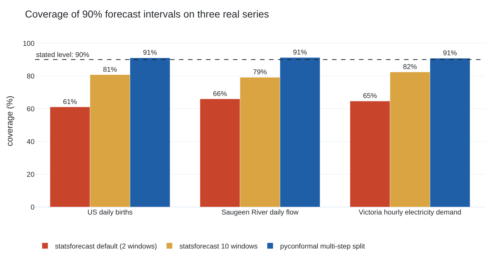
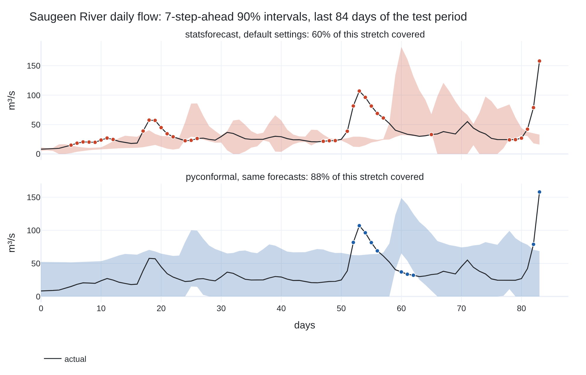
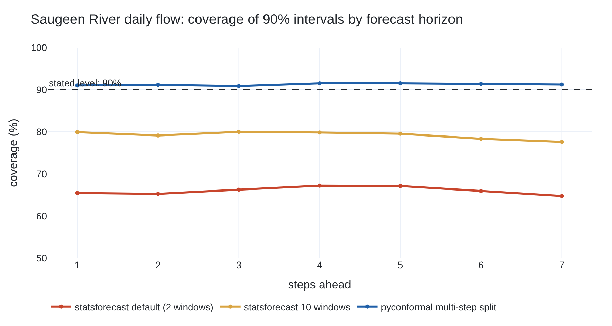
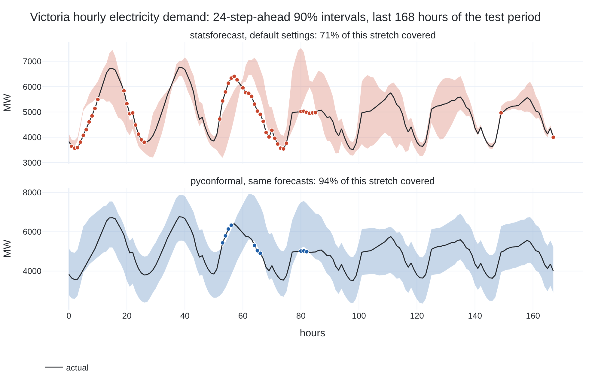
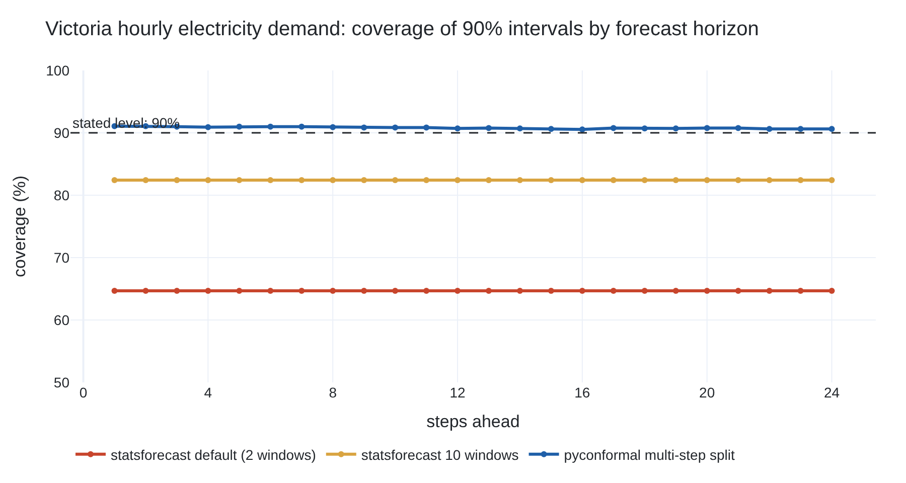
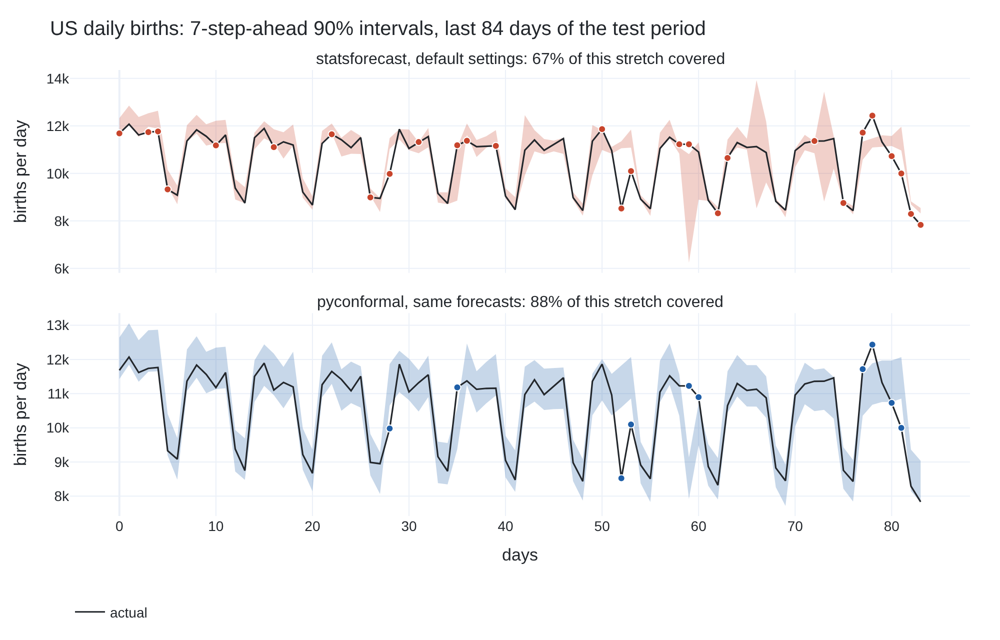

# Case studies: forecast intervals on real series

Three public series, one question: when a library says "90% interval", how often does the interval contain what happened?

| Series | Frequency | Forecast horizon | Source |
|---|---|---|---|
| US births, 1969–1988 | daily | 7 days | Monash archive |
| Saugeen River flow at Walkerton, 1915–1979 | daily | 7 days | Monash archive |
| Electricity demand, Victoria (Australia) | hourly (averaged from half-hourly) | 24 hours | Monash archive |

## Setup

- **Forecasts.** statsforecast 2.1.1 makes every point forecast: seasonal naive for births and electricity, naive for the river. At each of 1,500 consecutive forecast origins it is fitted to the most recent history (364 days, or 28 days of hourly data) and forecasts the full horizon.
- **statsforecast intervals.** `ConformalIntervals(h=H)`, level 90, called once per origin as a user would. Run twice: with the default 2 calibration windows, and with 10.
- **pyconformal intervals.** The same point forecasts go to `MultiStepSplitConformal(alpha=0.1, symmetric=True, min_calibration=30)`. For each target it uses only the forecast errors that were already known when the forecast was made.
- **Scoring.** Coverage is counted over the same targets for every method, after the first 100 origins.

## Result

| Series | Method | Coverage at 90% | Lowest horizon | Median width |
|---|---|---|---|---|
| US births | statsforecast, default | 61.1% | 61.1% | 518 |
| | statsforecast, 10 windows | 80.8% | 80.8% | 890 |
| | **pyconformal, multi-step split** | **91.0%** | 91.0% | 1,234 |
| | pyconformal, multi-step split, last 200 errors | 89.6% | 89.4% | 1,212 |
| | pyconformal, AcMCP | 89.9% | 89.7% | 2,025 |
| Saugeen River | statsforecast, default | 66.0% | 64.8% | 10.7 |
| | statsforecast, 10 windows | 79.2% | 77.6% | 29.0 |
| | **pyconformal, multi-step split** | **91.3%** | 90.9% | 74.8 |
| | pyconformal, multi-step split, last 200 errors | 89.4% | 88.7% | 66.8 |
| | pyconformal, AcMCP | 89.7% | 89.2% | 233 |
| Victoria electricity | statsforecast, default | 64.7% | 64.7% | 1,015 |
| | statsforecast, 10 windows | 82.4% | 82.4% | 1,839 |
| | **pyconformal, multi-step split** | **90.8%** | 90.6% | 2,393 |
| | pyconformal, multi-step split, last 200 errors | 88.4% | 87.9% | 2,327 |
| | pyconformal, AcMCP | 89.3% | 87.8% | 5,941 |

About 1,390 targets per horizon in each row. Widths are in the units of the series (births per day, m³/s, MW).

## What the numbers say

**The default misses a third of the time.** With 2 calibration windows there are two past errors per horizon. No finite interval built from two errors can be a valid 90% interval; nine is the minimum. statsforecast returns a finite interval anyway, with no warning, and it covers 61% to 66%. This is [statsforecast issue #1349](https://github.com/Nixtla/statsforecast/issues/1349).

**Ten windows is still short.** Coverage rises to about 80%. Ten errors are enough for a valid 90% interval, but only if the largest is used. statsforecast takes an ordinary interpolated quantile, which lands just above the second largest.

**pyconformal reaches the stated level on the same forecasts.** The point forecasts are identical. Only the calibration differs.

**The intervals are wider, because they have to be.** A 61% interval is narrower than a 90% interval. The narrow one is not a better interval; it is a different interval with the wrong label.

## What it looks like

Each figure shows the same stretch twice: statsforecast at its defaults above, pyconformal below. Dots are outcomes that fell outside the interval.

### Saugeen River, 7 days ahead

The lower ends are clipped at zero in this figure for both libraries, since a flow cannot be negative; this does not change coverage.

### Victoria electricity demand, 24 hours ahead

### US births, 7 days ahead

## Other forecasting models

The same comparison with statsforecast's AutoETS and AutoTheta. These refit at every origin and are slow with conformal intervals, so two of the three runs are short and their coverage figures are rough.

| Series | Model | Targets per horizon | statsforecast, default | statsforecast, 10 windows | pyconformal |
|---|---|---|---|---|---|
| Saugeen River | AutoETS | 1,093 | 63.4% | 79.5% | 90.0% |
| Victoria electricity | AutoTheta | 276 | 68.8% | 89.6% | 94.2% |
| US births | AutoETS | 93 | 65.0% | 81.6% | 86.9% |

## Limits

- **No guarantee on a time series.** Split conformal coverage is guaranteed for exchangeable errors. Forecast errors are not exchangeable, so 90% here is an observed result, not a theorem. The windowed variant and the short AutoETS run on births both land a little under 90%.
- **AcMCP is wider here.** It reaches the level, but with its default step size and no scorecaster its intervals are 1.6 to 3 times wider than multi-step split on these series.
- **Three series, one machine, simple forecasters.** This is an illustration, not a benchmark study.
- **statsforecast with more windows does better.** The fault is the default and the missing warning, not the method.

## Reproduce

Scripts and instructions are in [`project/benchmarks/case_studies/`](../benchmarks/case_studies/).
